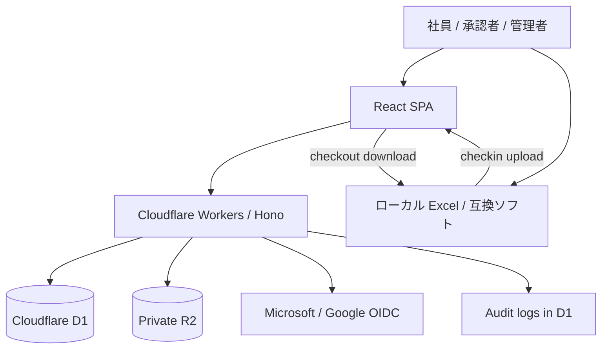
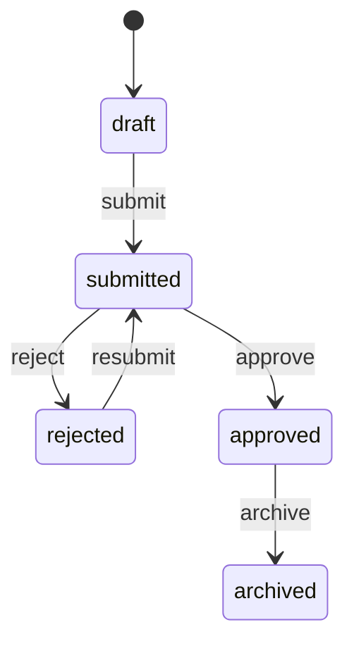

# 勤務表提出・ファイル管理Webアプリ 設計書

- Project: Timesheet Portal
- Version: 1.0 / 2026-11-16
- Status: Implementation-ready MVP design
- Runtime: Cloudflare Workers / D1 / R2
- Target: Codex implementation

## 0. 最重要要件と決定事項

勤務表は既存の `.xlsx` ファイルとし、Excel for the web / Microsoft 365 / SharePoint / OneDriveへの依存を排除する。ブラウザー上での表計算編集機能は作らない。利用者はチェックアウト後、手元のExcelで編集し、チェックイン時に更新ファイルを送信する。

- 組織内の社員は、自分の勤務表を作成・閲覧・編集・提出できる。
- 承認者は割り当て対象の勤務表を閲覧・承認・差戻しできる。
- 管理者はユーザー、テンプレート、権限、全体履歴を管理できる。
- 同一勤務表には有効なチェックアウトロックを**最大1件**だけ許容する。
- ファイルの各版はR2へ**不変キー**で保存し、上書きしない。
- 提出版はチェックイン済みの最新版を指し、提出時にその版番号とハッシュを確定する。提出後の更新は差戻しを要する。
- ロックはWebアプリのチェックイン操作を制限する「協調的なロック」。ローカルExcel編集自体は停止できない。
- ID/パスワードとOIDC SSO（Microsoft個人アカウントまたはGoogle）を併用。アカウント紐付けは本人確認済み操作のみで行う。
- できるだけCloudflare Freeの範囲で運用。容量・リクエスト・メール送信費用は別途監視。

### 非対象（MVP）
- ブラウザー内でのExcel編集、共同リアルタイム編集、Excelセル単位の競合解消
- マクロ付き `.xlsm` の完全対応、Excel計算エンジン、勤務時間の数式再計算
- HR/給与システム連携、組織内ファイル検索の全文索引、ウイルス対策の完全自動化
- デスクトップExcelのファイルへの独占ロック付与、OSレベルのファイル共有制御

## 1. 技術スタック

| Layer | Choice | Note |
|---|---|---|
| Frontend | React + TypeScript + Vite | SPA, responsive |
| UI | Tailwind CSS + accessible UI primitives | WCAG基本対応 |
| Backend | Hono + TypeScript on Cloudflare Workers | REST under `/api/v1` |
| Validation | Zod | runtime schemas |
| Database | Cloudflare D1 / SQLite | migrations SQL |
| Object storage | Private Cloudflare R2 | no public buckets |
| Authentication | App-local sessions, Password login + OIDC via Microsoft/Google | see auth section |
| Password hash | Argon2id if a vetted Workers-compatible implementation passes runtime/performance tests; otherwise WebCrypto PBKDF2-SHA256 with per-user salt and documented work-factor benchmark | never SHA256(password) |
| Testing | Vitest + Playwright | integration and E2E |
| Deploy | Wrangler + GitHub Actions (optional) | separate dev/prod environments |

### 設計上の依存制約

- 外部IDプロバイダーをSSOに使ってもExcel Onlineの有料ライセンスは不要。
- 個人MicrosoftアカウントでのSSOは**Excelへのアクセス権を意味しない**。
- パスワード復旧メール、招待メール等は送信手段が必要。MVPでは管理者の招待リンク手渡しで開始できるようにし、本番化時にメール配信サービスを追加する。
- 利用者が`.xlsx`を開くにはローカルのExcel、または互換アプリが必要。デスクトップ版ExcelのライセンスはこのWebアプリの無料構成に含まれない。

## 2. 論理アーキテクチャ



MVPはWorkers経由の認証済みファイル転送とする。サイズ上限は **10 MiB**（環境変数で変更可）。将来大きいファイルが必要ならR2署名付きURLと二段階確定フローへ移行する。署名付きURLはURLを知る人が期限内に利用できるため、短寿命・一時キー・確定時検証が必須。

## 3. ロールと権限

| 操作 | employee(owner) | approver(assigned) | admin |
|---|---|---|---|
| 自分の一覧・閲覧 | Yes | - | Yes |
| 自分のフォルダへの勤務表アップロード・更新 | Yes | No | 監査付き操作 |
| 自分の提出 | Yes | No | No（原則） |
| テンプレート配布フォルダの閲覧・ダウンロード | Yes | Yes | Yes |
| 割当先勤務表の閲覧 | No | Yes | Yes |
| 承認/差戻し | No | submittedのみ | Yes |
| テンプレート管理 | No | No | Yes |
| 他人のロック強制解除 | No | No | Yes + reason |

実装では「roleだけ」ではなくownerとassignmentをサーバーで毎回確認。URLのIDを知っているだけでは閲覧不可。

## 4. 状態モデル

### 4.1 勤務表の業務状態 `status`

- `draft`: 作成直後または未提出。チェックアウト可能。
- `submitted`: 提出済み。社員による更新禁止。承認待ち。
- `rejected`: 差戻し。社員の再編集・再提出可能。
- `approved`: 承認済み。更新不可。
- `archived`: 保管完了。更新不可。



### 4.2 編集ロック `checkout`

- `active`: 指定ユーザーが編集権を保持。
- `checked_in`: 正常チェックインで終了。
- `cancelled`: 変更なしで解放。
- `expired`: 期限切れ（論理的に無効）。
- `revoked`: 管理者解除。

ロックと業務状態は独立。`draft` + `active` は可能、`submitted` + `active` は不可。

**既定リース時間** 60分、更新上限は最大24時間。チェックアウト中に他ユーザーが編集を開始できない。期限切れ後は別ユーザーがロック取得できる。古いロックのチェックインは**409 Conflict**とし、無条件の上書きはしない。クライアントは編集済みファイルを保持し、利用者に再取得・差分確認を促す。

## 5. 主要ユーザーフロー

### 5.1 勤務表アップロード
1. 管理者がテンプレート配布フォルダへ`.xlsx`を配置する。社員には読み取り専用で公開する。
2. 社員がテンプレートをダウンロードし、自分の端末で記入する。
3. 社員が自分の個人フォルダへ対象月と`.xlsx`をアップロードする。APIが対象ユーザー・対象月の重複とフォルダ書込み権限を検証する。
4. D1に `timesheets` と初期 `file_versions`を登録し、R2へ**不変オブジェクトキー**で保存する。
5. 失敗時は未参照オブジェクトの削除対象としてマークする（R2とD1間の分散トランザクションは存在しない）。

### 5.2 チェックアウト
1. `POST /api/v1/timesheets/:id/checkout`。サーバーが認証・権限・状態を検証。
2. D1に対し**条件付き更新**により既存ロックが無い/期限切れである場合のみ取得する。
3. 成功すると`lockId`、一度だけ表示する`checkoutToken`、`expiresAt`、`version`を返す。
4. ダウンロードURLは認証済みAPI `/download`（別途呼出）で提供。ブラウザーからExcelをダウンロード。
5. トークンはサーバーではハッシュで保持。ブラウザーではセッション中のみ保持し、リロード時の復元方法はユーザー再認証と安全なロック再発行を設計する。LocalStorageへの永続保存は禁止。

### 5.3 チェックイン
1. ローカルExcelを保存し、ファイル選択から最新版`.xlsx`をアップロード。
2. `POST /api/v1/timesheets/:id/checkin` は`lockId`、`checkoutToken`、`expectedVersion`、`Idempotency-Key`を要求。
3. サイズ/MIME/拡張子/ZIPマジック・構造/不正なパスを検証。MIMEや拡張子**だけ**を信頼しない。
4. D1でロック所有者・期限・版番号を確認。R2へ一時オブジェクトを置きSHA-256を計算。
5. 一時オブジェクトをそのまま最終不変キーとして採用可能な命名にする（例`versions/{timesheetId}/{newVersion}/{uuid}.xlsx`）。最終確定前は未参照状態とする。
6. 同時操作を**D1の条件付きUPDATE (CAS)**と整合する版履歴INSERTで確定させ、ロックを終了する。競合時は409、未参照R2オブジェクトは安全に後から回収。
7. ファイル形式の検証はアプリの保安上の最低限に過ぎず、アップロードファイルの安全性を保証しない。必要に応じウイルススキャンサービスを追加。

### 5.4 提出
1. 自分の`draft/rejected`で、有効な編集ロックがないことを確認。
2. 現在版（`version`, `r2Key`, `sha256`）を提出レコードへ固定。
3. `status=submitted`にCAS更新。提出後は編集操作をAPIで拒否。
4. 管理者画面に反映。再提出時は新規提出履歴を記録。

### 5.5 承認・差戻し
- `submitted`に対してapprover/管理者が承認/差戻し可能。
- 差戻し理由は必須。差戻しで`rejected`となり再チェックアウト可能。
- 承認した版番号を`approved_version`に保持。過去の版は削除しない。

## 6. データモデル（D1 / SQLite）

### 方針
- UUID（TEXT）を主キーとして利用。日時はUTC ISO8601で統一。
- `current_version`の変更はCASで更新。
- 編集ロックの一意性は`timesheets`行の単一ロック情報で担保（複数active行の競争を避ける）。
- 監査レコードはappend-only、パスワード/生トークン/Excel内容を監査ログへ出さない。

### テーブル

`users`: `id`, `login_id`, `display_name`, `role`, `disabled_at`, `created_at`, `updated_at`。`login_id`の一意性は正規化後の社内ログインIDに対して設定する。メールアドレスは収集・保存しない。SSO識別はメールでなくprovider subjectで行う。

`password_credentials`: `user_id` (PK/FK), `hash`, `algorithm`, `params_json`, `updated_at`, `failed_attempts`, `blocked_until`。自己登録は無効、招待・管理者作成のみ。

`external_identities`: `id`, `user_id`, `provider`, `issuer`, `subject`, `created_at`; UNIQUE(`issuer`,`subject`)。

`sessions`: `id_hash` (PK), `user_id`, `created_at`, `expires_at`, `revoked_at`, `last_seen_at`; HttpOnly CookieのランダムなセッションIDは生値をDBへ保存しない。

`invitations`: `id`, `login_id`, `role`, `token_hash`, `expires_at`, `consumed_at`, `created_by`。招待にもメールアドレスを使わない。

`folders`: `id`, `name`, `parent_id`, `kind` (`template_library`/`personal`/`shared`), `owner_user_id`, `read_only`, `created_by`, `created_at`, `updated_at`。テンプレート配布フォルダは`read_only=1`とし、社員は閲覧・ダウンロードのみ許可する。

`folder_permissions`: `id`, `folder_id`, `user_id`または`role`, `can_read`, `can_write`, `created_at`。権限はフォルダ単位で管理し、UIの表示だけでなくAPIの全ファイル操作で検証する。

`templates`: `id`, `folder_id`, `name`, `version`, `r2_key`, `sha256`, `size_bytes`, `created_by`, `created_at`, `active`。管理者のみテンプレート配布フォルダへ追加・更新できる。

`timesheets`: `id`, `folder_id`, `user_id`, `target_month` ('YYYY-MM'), `template_id`, `status`, `current_version`, `current_r2_key`, `current_sha256`, `lock_id`, `lock_user_id`, `lock_token_hash`, `lock_base_version`, `lock_expires_at`, `lock_revoked_at`, `submitted_version`, `approved_version`, `created_at`, `updated_at`; UNIQUE(`user_id`, `target_month`)。1人1か月1勤務表のMVP仕様。

`file_versions`: `id`, `timesheet_id`, `version` (INT), `r2_key`, `sha256`, `size_bytes`, `created_by`, `created_at`; UNIQUE(`timesheet_id`,`version`), UNIQUE(`r2_key`)。

`submissions`: `id`, `timesheet_id`, `version`, `submitted_by`, `submitted_at`, `decision`, `reviewed_by`, `reviewed_at`, `rejection_reason`, `version_sha256`。再提出ごとに追記。

`approver_assignments`: `id`, `approver_id`, `employee_id`, UNIQUE(`approver_id`,`employee_id`)。

`audit_events`: `id`, `actor_id`, `entity_type`, `entity_id`, `action`, `details_json`, `request_id`, `created_at`。

`idempotency_records`: `id`, `user_id`, `route`, `key`, `request_hash`, `response_json`, `status_code`, `created_at`, `expires_at`; UNIQUE(`user_id`,`route`,`key`)。`processing`フラグで同一キーの同時操作を拒否/再試行制御。

> Codex: 実際の`migrations/0001_initial.sql`を作る。FK/UNIQUE/CHECK/indicesを必ず入れ、ロック状態/版/提出の原子的更新にはSQLの`WHERE`条件と`changes`確認を用いる。D1 APIのトランザクション可能範囲を確認し、単なる読み取り→更新の2段階は避ける。

## 7. API契約

全APIは`/api/v1`、JSONは`application/json`、認証はHttpOnly Cookie。変更系はCSRF保護と`Origin`検証。ファイル応答は`Content-Disposition: attachment`、`Cache-Control: private, no-store`。

| Method | Route | Request | Response | Auth |
|---|---|---|---|---|
| POST | `/auth/password/login` | `{ loginId, password }` | `{ user }` + session cookie | Public + rate limit |
| POST | `/auth/logout` | `{}` | 204 | Login |
| GET | `/auth/oidc/:provider/start` | query `returnTo` (allowlisted) | 302 provider | Public |
| GET | `/auth/oidc/:provider/callback` | code/state | 302 app + cookie | Public |
| GET | `/me` | - | user info | Login |
| POST | `/auth/invitations/accept` | `{ token, password? }` | session or success | Invite |
| GET | `/timesheets` | query month/status | paginated items | Owner/Reviewer |
| POST | `/timesheets` | multipart `{ targetMonth, file }` | `201` item | Employee（自分の個人フォルダ） |
| GET | `/timesheets/:id` | - | item/version/lock metadata | RBAC |
| POST | `/timesheets/:id/checkout` | `{ expectedVersion }` | lock token, expiry | Owner, draft/rejected |
| POST | `/timesheets/:id/checkout/renew` | `{ lockId, checkoutToken }` | new expiry | Lock owner |
| DELETE | `/timesheets/:id/checkout` | `{ lockId, checkoutToken }` | 204 | Lock owner |
| GET | `/timesheets/:id/download` | query `version?` | attachment .xlsx | RBAC |
| POST | `/timesheets/:id/checkin` | multipart file + `lockId`, `checkoutToken`, `expectedVersion`, `Idempotency-Key` | new version | Lock owner |
| POST | `/timesheets/:id/submit` | `{ expectedVersion }` | submitted | Owner |
| POST | `/timesheets/:id/approve` | `{ submissionId }` | approved | Assigned approver/admin |
| POST | `/timesheets/:id/reject` | `{ submissionId, reason }` | rejected | Assigned approver/admin |
| GET | `/timesheets/:id/versions` | - | versions | RBAC |
| GET | `/timesheets/:id/history` | - | audit trail | RBAC |
| POST | `/admin/timesheets/:id/revoke-lock` | `{ reason }` | revoked | Admin |
| GET/POST | `/admin/users` | list/create invite | items | Admin |
| GET/POST | `/admin/templates` | list/upload | items | GET: Login / POST: Admin |

### Status codes / error contract
- `400 VALIDATION_ERROR`
- `401 UNAUTHENTICATED`
- `403 FORBIDDEN`
- `404 NOT_FOUND` (隠すべき他人のデータも404)
- `409 LOCKED | LOCK_EXPIRED | VERSION_CONFLICT | INVALID_STATUS | IDEMPOTENCY_CONFLICT`
- `413 FILE_TOO_LARGE`
- `415 INVALID_FILE_TYPE`
- `422 INVALID_WORKBOOK`
- `429 RATE_LIMITED`
- `500 INTERNAL_ERROR`

エラー例:
```json
{"error":{"code":"LOCKED","message":"この勤務表は他の利用者が編集中です","requestId":"..."}}
```

### 代表的なロック取得CAS

```sql
UPDATE timesheets
SET lock_id = ?1,
    lock_user_id = ?2,
    lock_token_hash = ?3,
    lock_base_version = current_version,
    lock_expires_at = ?4,
    lock_revoked_at = NULL,
    updated_at = ?5
WHERE id = ?6
  AND user_id = ?2
  AND status IN ('draft', 'rejected')
  AND current_version = ?7
  AND (lock_id IS NULL OR lock_expires_at <= ?5 OR lock_revoked_at IS NOT NULL);
```

更新行数が1のときだけ取得成功。既存のロックを期限切れで乗っ取った場合でも、以前のトークンではチェックイン不可とする。期限切れと明示キャンセルの監査イベントを記録する。

### チェックインのCAS

R2へ保存した後、`current_version=expectedVersion` と `lock_id=lockId` と `lock_token_hash=hash(token)` と`lock_user_id=caller` と `lock_expires_at > now` と`status IN (...)`を **1回のUPDATE条件** で検証し、成功した場合だけ`current_version+1`と`current_r2_key`等を更新しロックをクリア。同じD1原子的処理内で履歴をINSERT。D1のSQL batch/トランザクション対応を事前に検証。失敗したR2版は未参照オブジェクトとしてGC対象。

## 8. セキュリティ

1. HTTPS専用。Cookie: `Secure; HttpOnly; SameSite=Lax; Path=/`。固定化対策でログイン時にセッションIDを再生成。
2. セッションIDは暗号学的乱数256bit、DBへSHA-256のみ保存。短めの有効期限（例8h）と明示ログアウト失効。
3. パスワードは十分な長さのパスフレーズを許可、使い回し判定は将来強化。平文保存、ログ出力、メール送信禁止。
4. パスワードログインと招待受け入れにIP/アカウントベースのレート制限、列挙防止応答。
5. OIDCはAuthorization Code + PKCE、state、nonce、issuer/audience/signature/expiry検証。認証プロバイダーごとの固定設定。自動メール一致によるアカウント統合は禁止。
6. CSRFはdouble-submit or server-side tokenとOriginチェックを併用。すべての変更系endpointで検証。
7. リダイレクト先はアプリ内部相対パスのみ許可（open redirect防止）。
8. R2バケットは非公開。APIの認可を通したファイル送信のみ。Content-Disposition attachment と`X-Content-Type-Options: nosniff`。
9. 許可するファイルは`.xlsx`のみ。最大10MiB、ZIPコンテナーとして妥当か検証し、zip bomb警戒。`xlsm`、任意拡張子、HTMLのアップロードを拒否。
10. R2 object keyに元のファイル名を使わずUUID。入力したファイル名はレスポンスヘッダーへ安全にエンコード。
11. 監査ログ: auth, checkout, renew, cancel, checkin, submit, approve, reject, admin unlock, download。
12. 個人情報を扱うためバックアップ、保持期間、退職者アクセス停止、管理者権限分離は本番前に確定。
13. 開発/本番DB・バケット・OIDC credentialsを分離。`.dev.vars` と秘密鍵をGitに入れない。

## 9. UI/画面設計

- `/login`: ログインID+パスワード、Microsoft/Googleログイン（メールアドレスは収集しない）
- `/dashboard`: SharePoint風のマイドキュメント、ファイル一覧、状態・更新日時・サイズ、検索・状態フィルター
- `/timesheets/new`: 対象月・`.xlsx`を自分の個人フォルダへアップロード
- `/timesheets/:id`: ファイル情報、ダウンロード、編集開始、アップロード、提出操作
- `/timesheets/:id/history`: 版履歴、提出履歴、承認履歴
- `/approvals`: 割当社員の提出済み勤務表一覧
- `/admin/users`: 招待、ロール、無効化
- `/admin/templates`: .xlsxテンプレート管理
- `/admin/audit`: 操作履歴

ユーザー向け画面では内部用語の「チェックアウト」「チェックイン」「編集権を取得」を避け、「編集する」「ファイルをダウンロード」「編集済みファイルをアップロード」「提出する」と表示する。編集開始後は「①ファイルをダウンロード ②Excelで編集・保存 ③編集済みファイルをアップロード ④提出する」をステップ表示する。ロック期限・残り時間と延長操作は、必要な場合だけ補助情報として表示する。ブラウザを閉じても編集ファイルはローカルに残るため、再開時の扱いをユーザーへ説明する。ロック再発行は既存ロックと厳密に紐付け、本人認証済みの場合のみ許可。

管理者のテンプレート配布フォルダは読み取り専用として表示し、社員の個人フォルダには「勤務表をアップロード」ボタンを表示する。

## 10. リポジトリ構成

```text
timesheet-portal/
├─ README.md
├─ DESIGN.md
├─ AGENTS.md
├─ package.json
├─ pnpm-workspace.yaml
├─ apps/
│  ├─ web/                      # React/Vite
│  │  ├─ src/pages/
│  │  ├─ src/components/
│  │  └─ src/lib/api.ts
│  └─ api/                      # Hono/Workers
│     ├─ src/index.ts
│     ├─ src/routes/
│     ├─ src/services/
│     ├─ src/repositories/
│     ├─ src/auth/
│     ├─ src/domain/
│     ├─ src/validation/
│     ├─ migrations/
│     ├─ wrangler.jsonc
│     └─ tests/
├─ packages/
│  └─ shared/                   # types, schemas, constants
├─ e2e/
└─ docs/
   ├─ decisions/
   └─ operations.md
```

単一ドメインでUIとAPIを配信する方式を推奨。SPA配信はCloudflare WorkersのStatic Assets/フロントのビルド成果物で統合できる。開発時はVite proxyでAPI接続。

## 11. 実装順序（Codex）

### Milestone 1: Scaffold / Infra
- monorepo, Hono, Vite, shared TypeScript, lint/format/test, Wrangler bindings
- D1 migration, private R2 dev bucket, local development scripts
- `/health`, typed error handling, request IDs

### Milestone 2: Auth/RBAC
- admin bootstrap（環境変数で一度だけ生成し、シークレットは使い捨て）
- password login, session, logout, invitation acceptance
- Microsoft/Google OIDC SSO; link by verified explicit action
- RBAC middleware, authorization tests, CSRF/rate limit

### Milestone 3: Timesheet/File lifecycle
- template management, timesheet creation, versioned R2 storage
- checkout / renew / cancel / admin revoke
- authorized download, checkin upload, CAS, conflict UX

### Milestone 4: Submission workflow
- submit, reject, approve, approver assignment, audit history
- immutable version retrieval and exports

### Milestone 5: E2E / security / release
- parallel lock contention; stale checkin; ownership/role bypass; malformed Excel; repeat submissions
- UI accessibility, backups, quotas monitoring, deployment checklist

## 12. 受け入れテスト（必須）

1. 同じ勤務表に同時チェックアウト要求を20件投げても、成功は**1件だけ**。
2. 別社員はオーナーのロック中でも編集不可。権限のない利用者は閲覧も不可。
3. ロック期限後に別人が取得した場合、旧トークンによるチェックインは409。
4. `expectedVersion`を改ざんしたチェックインは409、最新ファイルは変化しない。
5. チェックイン中に通信が切れても、古い版とR2オブジェクトは回収可能で整合性が崩れない。
6. 同一Idempotency-Keyのチェックイン再試行で版は増えない。
7. 提出中の勤務表はチェックアウト/チェックイン不可。
8. 差戻し→再チェックイン→再提出では版履歴も提出履歴も保存される。
9. 承認者は割当済み社員のみ承認できる。社員は自分の勤務表を自己承認できない。
10. 無効化ユーザー/期限切れセッションでは全保護APIが拒否される。
11. 署名/拡張子不正、10MiB超、zip bomb疑いのファイルは拒否される。
12. SSOの不正state, nonce, issuer, audienceはログイン不可。
13. CSRFなしの変更系リクエストは拒否される。
14. 版のダウンロードによりアップロード時のSHA-256と同じ内容を取得できる。
15. 監査履歴にパスワード・セッショントークン・チェックアウトトークンが出ない。

## 13. 運用と費用

- Workers/D1/R2の無料枠の最新条件をデプロイ時に公式サイトで再確認する。
- 無料枠超過やR2バケット利用時の支払い方法登録の要否は環境により確認する。
- 独自ドメイン（必要時）、メール配信、SSOプロバイダーの利用条件、デスクトップExcel、監視サービスは別途。
- D1の定期バックアップ、R2の不変版保持、データ復旧手順を本番前に準備する。
- R2孤児オブジェクトは参照一覧と比較し、猶予期間経過後に安全に削除。参照中の版は削除禁止。
- 月別保管期間（例7年等）は法令と会社の規程に応じて決定し、勝手に設定しない。

## 14. リスク・判断待ち（実装は初期値で進める）

| 論点 | MVP初期値 | 将来 |
|---|---|---|
| 共有編集 | 1ファイル1ロック | 共同編集は別製品連携 |
| ロック時間 | 60分/24時間まで延長 | 組織ポリシー化 |
| 最大ファイル | 10MiB | 署名URL/大容量対応 |
| アカウント登録 | 管理者招待制 | メール自動通知 |
| SSO | Google / Microsoft個人 | 法人Entra ID等 |
| Excelテンプレート | 管理者アップロード | テンプレート版管理強化 |
| 利用者範囲 | 単一組織 | マルチテナントは別途設計 |
| 監査・保持 | 無期限を仮定しない | 会社の規程で確定 |

## 15. 公式資料

- R2 Workers API: https://developers.cloudflare.com/r2/api/workers/workers-api-reference/
- R2 presigned URL: https://developers.cloudflare.com/r2/api/s3/presigned-urls/
- Workers Web Crypto: https://developers.cloudflare.com/workers/runtime-apis/web-crypto/
- R2 local development: https://developers.cloudflare.com/r2/get-started/workers-api/
- Cloudflare D1: https://developers.cloudflare.com/d1/
- Microsoft identity platform: https://learn.microsoft.com/en-us/entra/identity-platform/v2-oauth2-auth-code-flow
- Google OIDC: https://developers.google.com/identity/openid-connect/openid-connect

## 16. Codex向け実装ルール

- この設計書を実装のSingle Source of Truthとする。
- 各Milestoneで動くテストとmigrationを含めて完結させる。
- 設計と異なる推奨変更がある場合は`docs/decisions/ADR-xxxx.md`に根拠を記録。
- パスワードの独自暗号化、認証トークンの平文保存、権限チェックのフロントエンド依存は禁止。
- リポジトリ上に本物の秘密情報・個人の勤務表をコミットしない。
- ダミーxlsxでE2Eテストを実施し、並行操作、ロック競争、ネットワーク障害を再現。
- 未実装の機能を完了済みと報告しない。
