# Excelブック編集・再計算アーキテクチャ調査報告

## 1. 結論

採用した方式は、元のXLSX/XLSMをZIPパッケージとして保持し、必要なワークシートXMLだけを更新する方式です。ExcelJS、SheetJS、Univerなどにブック全体を読み込ませて再保存する方式は採用していません。これにより、`xl/vbaProject.bin`、名前定義、書式、結合、条件付き書式、入力規則、描画・印刷関連パーツを元のパッケージのまま保持できます。

再計算は次の二段階です。

1. Worker内で確実に計算できる勤怠計算、カレンダー、会社提出用の直接参照、既知のABCS集計結果を計算し、数式を残したままキャッシュを更新する。
2. Workerで実行できないVBA/UDF・未対応数式は古いキャッシュを消去し、Excel起動・保存時に完全再計算する設定を付ける。

したがって、ダウンロード成功と完全再計算成功は分離して扱います。レスポンスヘッダーにも `partial;deterministic-cache;deferred-to-excel` を付与しています。

## 2. 現行アーキテクチャの調査

### テンプレート取得

[attendance.ts](../apps/api/src/routes/attendance.ts) の `attendanceTemplate` がD1のテンプレートメタデータを検索し、R2からバイト列を取得します。出力形式ごとのテンプレート名パターンを持ち、XLSMは拡張子とContent-Typeを維持します。

### 編集・エクスポート

[export.ts](../apps/api/src/attendance/export.ts) がテンプレートを `fflate.unzipSync` で展開し、`xl/worksheets/*.xml`、`xl/workbook.xml`、必要な `xl/styles.xml` のみを変更して、最後に `zipSync` で再パッケージ化します。

### 既存の編集処理

既存処理には、セル値の入力、入力欄の初期化、カレンダーキャッシュ、提出用参照キャッシュ、ABCS勤務・残業集計、VBAチェック結果の反映があります。以前は一部のセル編集とキャッシュ更新に正規表現によるXML編集が使われていました。

今回、計算キャッシュの更新と独立した [workbook.ts](../apps/api/src/excel/workbook.ts) のDOMベース更新関数を追加し、`WorkbookEditor` のセル更新と数式キャッシュ更新は `@xmldom/xmldom` でXML構造を解析して行うようにしました。ZIP全体をライブラリで再生成することはありません。

### VBA・数式

VBAは `xl/vbaProject.bin` を読み書きせず、そのまま保持します。Worker内ではVBAを実行しません。

実テンプレートの調査結果：

- 入力用シートの数式：約2256個
- 会社提出用シートの数式：約400個
- `勤務時間`、`残業時間`、`COUNTIF2`、`代休取得時間`、`遅刻早退時間`などVBA/UDF依存の数式が存在
- 共有数式、配列的な参照、名前定義、印刷範囲、印刷設定、描画、コメント、入力規則を含む
- `xl/calcChain.xml` が存在
- デジタル署名パーツは確認できなかった

## 3. 発見した問題点

1. Excel互換ライブラリでブック全体を再保存すると、VBA・印刷設定・描画・条件付き書式などの欠落リスクが高い。
2. HyperFormulaなどの汎用計算エンジンは標準関数には対応するが、今回のVBA/UDFを再現できない。
3. 旧テンプレートに残る数式キャッシュは、変更セルの依存先である場合だけ別ユーザー・別月の値になる。全キャッシュ消去は正常な既存値まで破棄するため不適切である。
4. `calcChain.xml` はセル変更後の依存関係と一致しない可能性があるため、削除してExcelに再構築させる必要がある。
5. WorkerではExcel COM、LibreOffice、`child_process`、ネイティブモジュールを利用できない。

## 4. 編集ライブラリの比較

| 候補 | XLSM/VBA保持 | 元パーツ保持 | Worker適合 | 採否 |
|---|---|---|---|---|
| ExcelJS | 再保存時の完全保持を保証できない | 低〜中 | JavaScriptだがサイズ・互換性の懸念 | 不採用 |
| SheetJS CE | VBA読込補助はあるが、元パーツを完全保持する編集器ではない | 低〜中 | 適合しやすい | 不採用 |
| Univer | 数式・編集機能は強いが、XLSM全パーツの不変部分更新用途では重い | 不明/変換依存 | Node/サーバー向け、Worker単体には不適 | 不採用 |
| fflate + DOMパーサー | 元ZIPを維持し、対象XMLだけ変更 | 高 | Worker適合 | 採用 |

## 5. 計算エンジンの比較

| 候補 | 標準関数 | 名前定義/依存関係 | VBA/UDF | ライセンス・運用 | 判断 |
|---|---|---|---|---|---|
| HyperFormula | Excel/Sheets互換関数、名前付き式、依存関係に強い | 対応あり。ただし制限あり | 非対応。独自関数を別途実装する必要 | GPLv3または商用 | 将来の標準式サブエンジン候補。ただし現テンプレート全体には不十分 |
| Formula.js | 多数の関数をJavaScriptで提供 | ブック依存関係の管理なし | 非対応 | コミュニティ実装 | 単体関数補助には使えるが採用しない |
| Univer Formula Engine | 500以上の関数、名前付き範囲、配列式など | 対応範囲は広い | VBA互換ではない | OSSコアと商用SDKの範囲に注意 | WorkerのXLSM部分更新には過剰 |
| Excel/VBA | 実テンプレートとの互換性が最も高い | 完全 | 対応 | Workerでは実行不可 | 開いたExcelでの最終再計算に委譲 |
| 現行の型安全な勤怠計算 + キャッシュ更新 | 対象業務式を正確に計算 | 対象範囲のみ | 対応不可 | 無料、Worker適合 | 今回採用 |

比較の根拠として、HyperFormulaは公式ドキュメント上でGPLv3または商用ライセンス、名前付き式とExcel互換関数を案内していますが、独自VBA関数は別実装が必要です。[HyperFormula公式](https://handsontable.com/docs/hyperformula/index.html)、[ライセンス](https://github.com/handsontable/hyperformula/blob/master/docs/guide/license-key.md)。Formula.js自身もExcelとJavaScriptの差異を明記しており、ブック依存関係の管理機能ではありません。[Formula.js公式](https://formulajs.info/)。Univerは数式エンジンを持ちますが、XLSX変換・複雑な書式や埋め込みオブジェクトの差異を実ファイルで確認する必要があり、今回のXLSM不変部分更新の要件には適合しません。[Univer公式](https://www.univer.ai/about/)。

## 6. 改善後アーキテクチャ

```mermaid
flowchart LR
  API[Hono /attendance/export] --> Repo[TemplateRepository]
  Repo --> R2[R2: original XLSX/XLSM bytes]
  R2 --> Editor[WorkbookEditor\nZIP package + DOM XML partial update]
  Editor --> Input[Input cells]
  Editor --> Formula[FormulaEngine]
  Formula --> Deterministic[Deterministic calculators\ncalendar / attendance / known ABCS totals]
  Formula --> Inventory[Formula inventory\nunsupported / deferred detection]
  Deterministic --> Cache[Formula cache writer\nformula preserved, v updated]
  Inventory --> Policy[Partial calculation policy\nold caches cleared]
  Policy --> CalcProps[calcMode=auto\nfullCalcOnLoad / forceFullCalc]
  Cache --> Integrity[OOXML integrity validator]
  CalcProps --> Integrity
  Integrity --> ZIP[Original parts + changed parts only]
  ZIP --> Download[Download XLSX/XLSM]
  Download --> Excel[Excel recalculates VBA/UDF on open/save]
```

`WorkbookEditor` はパッケージの読み込み・セル更新・保存を担当し、`FormulaEngine` は計算結果と評価状態だけを返します。計算エンジンはブック全体を保存しません。

## 7. 変更ファイル

- [apps/api/src/excel/workbook.ts](../apps/api/src/excel/workbook.ts)：DOMベースのセル更新・数式キャッシュ更新を追加
- [apps/api/src/excel/formulas.ts](../apps/api/src/excel/formulas.ts)：数式インベントリ、共有数式の相対参照展開、依存関係の推移的な影響範囲解析を追加
- [apps/api/src/attendance/export.ts](../apps/api/src/attendance/export.ts)：変更セル記録、依存範囲だけのキャッシュ無効化、決定的計算の再投入、Excel再計算要求
- [apps/api/src/routes/attendance.ts](../apps/api/src/routes/attendance.ts)：計算状態をレスポンスヘッダーで可視化
- [apps/api/tests/excel-platform.test.ts](../apps/api/tests/excel-platform.test.ts)：DOM編集・数式インベントリのテスト
- [apps/api/tests/attendance-export.test.ts](../apps/api/tests/attendance-export.test.ts)：古いキャッシュを出力しない回帰検証

## 8. 再計算処理の詳細

1. 元テンプレートをR2から取得。
2. 入力セルを更新。
3. 数式XMLと共有数式の親・子を解析し、変更セルからの依存関係を推移的にたどる。
4. 影響を受ける数式セルだけキャッシュをクリアする。共有数式の子は相対参照を展開して個別に判定する。
5. 日付・曜日、勤務時間、普通残業、休日残業、深夜残業、会社提出用参照を再計算。
5. 数式タグは保持し、`<v>`だけをDOM経由で更新。
6. 未対応式は、影響範囲に入った場合だけ空キャッシュにし、変更範囲外の既存キャッシュは保持する。
7. 入力セルを変更した場合は `calcChain.xml` を削除し、Excelに依存関係を再構築させる。
8. `calcMode="auto"`、`fullCalcOnLoad="1"`、`forceFullCalc="1"`、`calcOnSave="1"`を設定。
9. 許可された変更パーツ以外のバイト差分を検証。
10. 元のパーツを維持したままZIP化。

## 9. 数式の対応状況

### Worker内で評価するもの

- 勤怠入力からの実労働分数
- 普通休憩・深夜休憩
- 日付・月末日・日付キャッシュ
- ABCS日別勤務時間・残業時間・休日/深夜集計
- 会社提出用の日別参照値と既知の合計欄

### Excelへ委譲するもの

- `勤務時間(...)`
- `残業時間(...)`
- `COUNTIF2(...)`
- `代休取得時間(...)`
- `遅刻早退時間(...)`
- テンプレート固有の名前付き式・VBA依存式
- Worker側で再現実装していない標準関数

未対応式は `FormulaInventory` で検出され、APIレスポンスの `X-TimeDock-Formula-Evaluation` に `unsupported=N` として出力されます。

### 実テンプレートのキャッシュ評価

比較値では数式総数は両ブックとも2,681個で一致し、入力用シート2,257個（共有数式1,859個）、会社提出用シート400個という構造も一致しています。一方、非空キャッシュはテンプレート2,327個、11月版2,408個です。この差は入力値が入ったセルやExcel保存時に更新されたキャッシュの差であり、正確性の証明ではありません。`fullCalcOnLoad`、`forceFullCalc`、`calcOnSave` はExcelに再計算を要求する設定であって、ダウンロード直後のキャッシュが正しいことを保証しません。

数式は次の3種類に分けて扱います。

- Workerで同値性を検証済み：決定的な勤怠集計と直接参照。入力値から独立計算した期待値とキャッシュを比較する。
- Excelで再計算が必要：標準関数、共有数式、名前定義、VBA/UDF依存式。影響範囲のキャッシュを空にし、Excel再計算フラグを付ける。
- Workerで計算不能：VBAソース未取得・未検証のUDF、外部リンク、未知の関数。結果を推測せず、影響範囲では空キャッシュとして扱う。

VBAプロジェクトはバイナリ保持を確認しましたが、`勤務時間`、`COUNTIF2`、`INTHM`、`HMINT` のコード本文を信頼できる形で抽出できていません。そのためTypeScript移植と同値性検証は未実施であり、現時点ではExcel再計算必須です。`Workbook_BeforePrint` に印刷前チェックと `Cancel` 制御があることは確認できますが、Web側のキャッシュ計算をもってVBAの印刷可否チェック完了とは扱いません。

## 10. テスト結果

- API TypeScriptビルド：成功
- APIテスト：全26テスト成功
- VBAバイナリ保持：検証済み
- 数式タグ保持：検証済み
- 既存名前定義保持：検証済み
- セル書式保持：検証済み
- 共有数式の保持：検証済み
- 入力用・会社提出用シート構成：検証済み
- 変更セルに依存するキャッシュだけの消去：検証済み
- 変更範囲外のキャッシュ保持：検証済み
- 共有数式の親・子と推移的依存関係：検証済み
- DOMベースのセル更新・キャッシュ更新：検証済み

## 11. 未解決の互換性問題

1. Cloudflare Workers単体ではExcel/VBAの計算エンジンを実行できないため、VBA UDFの完全な事前再計算はできません。
2. HyperFormulaを導入しても、今回の主要なVBA UDFは別途再実装が必要です。
3. デジタル署名付きブックは編集により署名が無効になるため、署名パーツを検出した場合にエクスポート拒否する処理は今後追加すべきです。
4. 動的配列、LET、LAMBDAなどを含む新テンプレートは、実テンプレートで追加検証が必要です。
5. 現在のABCS計算はテンプレートの既知セル構造に依存するため、テンプレート変更時は数式インベントリと回帰テストを更新する必要があります。

## 12. 今後の改善案

- テンプレート登録時に数式インベントリ、名前定義、署名、VBA有無を保存する。
- `勤務時間`・`残業時間`などのVBA関数を業務仕様としてTypeScriptに移植し、Excel既知結果との比較テストを追加する。
- 標準関数だけを対象にHyperFormulaを別プロセスではなくWorkerバンドルのオプション機能として評価する。ただしGPLv3の配布条件を確認する。
- 実テンプレートを固定fixture化し、Excelで保存した既知の正解値との比較をCIに追加する。
- 署名付きファイル、循環参照、エラー値、空白、日付、シート間参照のfixtureを追加する。
