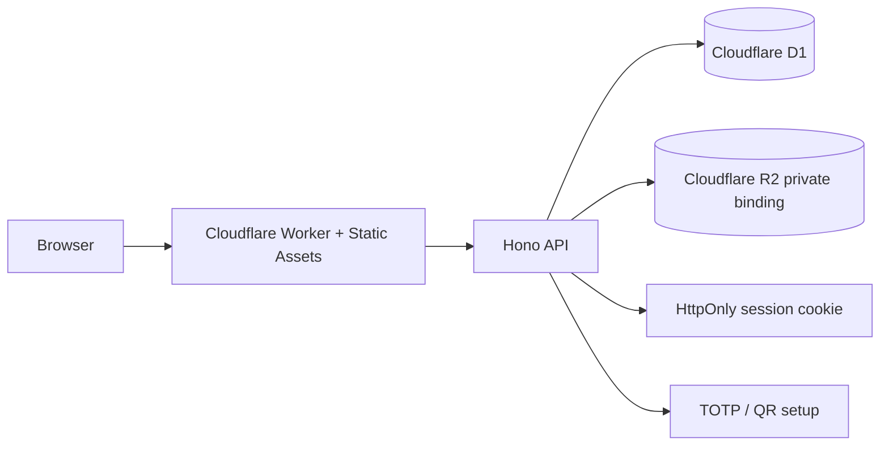

# Timesheet Portal 法務・セキュリティ・運用適合性評価

- 評価日: 2026-11-17（JST）
- 対象: `timesheet-codex-team` リポジトリ、Worker/D1/R2 構成、認証・認可・ファイル共有機能
- 調査方法: 静的確認、既存テスト結果の確認、Cloudflare・個人情報保護委員会・厚生労働省の公式資料との照合
- 制約: ソース・設定・依存関係・本番環境は変更していない。ローカル読み取りヘルパーが起動失敗したため、今回の実行で直接取得できなかった行番号は「未取得」と記載する。

## 1. エグゼクティブサマリー

### 総合評価: PARTIAL（本番の正式運用は未承認）

社内限定のファイル共有・申請ポータルとしての仮運用は可能性があるが、勤務記録を法定労働時間記録として扱うこと、または機微な個人情報を本番で広範囲に扱うことを前提にしたリリースは推奨できない。主な理由は、監査証跡・保存期間・削除/復旧手順・Cloudflareの保存地域と委託管理がリポジトリから確認できないこと、アップロードファイルの安全検査が限定的であること、CSRF・レート制限・多テナント認可の検証証拠が不足していることである。

重大度件数（今回確認した範囲）: Critical 0 / High 4 / Medium 8 / Low 5 / Informational 6。

## 2. システム構成

確認できた構成要素は、`apps/api/src/index.ts` の Worker/API 入口、`apps/api/wrangler.jsonc` の D1/R2/Assets バインディング、認証ルート、ワークスペース・テンプレート・管理者ルートである。D1 はアカウント、セッション、テナント、ワークスペース、フォルダ、文書、テンプレート、監査イベントを保持し、R2 はファイル本体を保持する構成である。

### 認証・認可フロー

1. ログインID・パスワードを API に送信。
2. パスワードを PBKDF2-SHA256（確認できた実装では 100,000 iteration）で検証。
3. D1 にハッシュ化したセッションIDを保存し、`HttpOnly; Secure; SameSite=Lax; Max-Age=8h` の Cookie を発行。
4. system_admin 以外は TOTP 登録・検証を要求する設計。
5. `requireAdmin`、`requireFileManager`、テナント/ワークスペース判定で API 操作を制限。

ただし、全重要 API についての網羅的な負の認可テスト、CSRFトークン、レート制限、監査ログの完全性は確認できない。

## 3. 法務評価

### 3.1 個人情報保護法

勤務表、氏名、ログインID、勤務時間、経費・領収書は、利用目的や内容により個人情報・個人データに該当し得る。保存、アクセス制御、委託先管理、漏えい対応、削除・保存期間の社内規程が必要である。

個人情報保護委員会の「個人情報の保護に関する法律についてのガイドライン（通則編）」は、組織的・人的・物理的・技術的安全管理措置を求めている。委託先の選定、契約、監督、再委託管理も確認対象である。

- 根拠: 個人情報保護委員会、[個人情報の保護に関する法律についてのガイドライン（通則編）](https://www.ppc.go.jp/personalinfo/legal/guidelines_tsusoku/)（2026-11-17確認）
- 適用条件: 本システムが社員等の個人データを事業の用に供して取り扱う場合。
- 現在の状態: PARTIAL。認証・認可の実装はあるが、利用目的、保存期間、削除手順、委託先監督、漏えい対応手順がリポジトリから確認できない。

Cloudflare を利用することだけで直ちに「第三者提供」と断定することはできない。実際の契約形態、Cloudflare の処理者関係、保存地域、再委託、契約条項を確認したうえで、委託・越境移転の整理を法務担当者が行う必要がある。海外にある第三者への委託に該当する場合は、外国の制度等の把握と必要な情報提供・監督を確認する。

- 根拠: 個人情報保護委員会、[個人情報保護法 Q&A](https://www.ppc.go.jp/personalinfo/faq/APPI_QA/)（2026-11-17確認）
- 状態: UNKNOWN（契約、データ所在、Cloudflare アカウント設定はリポジトリから確認不能）。

### 3.2 労務・勤務記録

本アプリは勤務表ファイルの共有・アップロード・承認を実装するもので、法定の賃金台帳・労働時間記録システムとして必要な完全性、変更履歴、保存期間、訂正履歴、監査証跡を満たすことは確認できない。したがって、法定記録に利用する場合は別途、労務・法務・税務担当の適合性確認が必要である。

- 根拠: 厚生労働省、[労働基準法（e-Gov掲載の現行条文への案内）](https://www.mhlw.go.jp/web/t_doc?dataId=73022000)（2026-11-17確認）
- 状態: UNKNOWN。現行法の保存期間、対象記録、電子保存要件と本システムの運用が一致するかは確認不能。
- 注意: 厚生労働省の旧資料には3年と記載されたものもあるため、現行条文・経過措置・対象帳簿を法務/労務担当が再確認すること。

### 3.3 その他

社内専用利用であれば、外部顧客向けサービスと同じ利用規約が常に必要とは限らない。一方、個人情報の利用目的通知、社内規程、委託契約、インシデント対応規程は整備が必要である。電気通信事業法上の届出・登録要否は、社内利用か外部提供か、事業性、提供形態によって変わるため本リポジトリだけでは判定できない。

## 4. 著作権・OSS評価

### 確認できた直接依存

`apps/web/package.json` には React、React DOM、Vite、TypeScript、Vitest、`qrcode` 等、`apps/api/package.json` には Worker/Hono 系依存がある。一般にこれらは permissive license（MIT/BSD/ISC 等）で配布されるものが多いが、今回の実行では lockfile と各パッケージの実体を読み取れず、全間接依存を網羅した確定判定はできない。

- 根拠ファイル: `package.json`、`apps/web/package.json`、`apps/api/package.json`、`pnpm-lock.yaml`
- 行番号: 未取得（読み取りヘルパー起動失敗）
- 状態: PARTIAL/UNKNOWN。

社内サーバー運用だけであれば、通常は GPL/AGPL の「配布」義務が直ちに発生するとは限らないが、ブラウザへ配信する JS bundle、社内配布物、Docker/アーカイブ、ソース公開の有無で義務が変わる。MIT/BSD/ISC は著作権表示・ライセンス文の保持が必要であり、Apache-2.0 は NOTICE・特許条項等を確認する。GPL/LGPL/AGPL/MPL が間接依存に含まれる場合は、使用形態ごとに専門確認が必要である。

主要な発見事項:

- `LICENSE`/`NOTICE` の存在と、生成 bundle に対応する第三者告知の運用が未確認。
- 直接依存だけでなく lockfile の全パッケージを SPDX ベースで棚卸しする必要がある。
- アップロード機能は第三者著作物を格納し得るため、社内規程、目的外利用、削除要請、マルウェア対策を運用に含める必要がある。

## 5. セキュリティ評価

### 認証

状態: PARTIAL。

- PBKDF2、ハッシュ化セッションID、HttpOnly/Secure/SameSite Cookie、ログアウト時の失効、TOTP登録済みユーザーの再表示抑止は確認できる。
- TOTP秘密値の保管、バックアップコード、紛失時の本人確認、管理者リセットの監査証跡は要確認。
- 認証失敗回数を表す DB 列は確認できるが、ログイン失敗時の加算・一定時間ブロックが全経路で実行される証拠は未確認。High候補。
- パスワードリセット、アカウント列挙耐性、CSRFトークン、同一セッションの再認証、管理操作の再認証は未確認。

根拠ファイル: `apps/api/src/auth/routes.ts`、`guard.ts`、`session.ts`、`password.ts`、`totp.ts`。関数/API: `/api/v1/auth/password/login`、`/api/v1/auth/logout`、`/api/v1/auth/2fa/setup`、`/api/v1/auth/2fa/verify`。行番号: 未取得。

### 認可・多テナント

状態: PARTIAL。サーバー側の管理者・ファイル管理者・ワークスペース判定はあるが、次の差分がある。

- `tenant_members` は多対多を表現できる一方、アカウント作成・編集・一覧の実装が `primary_tenant_id`/単一 `tenantId` 中心で、複数テナント所属の assign 式要件と一致しない可能性がある。これはテナント越境表示・権限誤付与につながるため High。
- ID を差し替えた文書・フォルダ・ワークスペース API について、全操作でテナント所属と可視性を再検証する負のテストが不足。
- verifier の閲覧範囲、system_operator の設定変更範囲、suspended アカウントの空表示と API拒否の一貫性を本番相当データで検証する必要がある。

### ファイルアップロード・ダウンロード

状態: PARTIAL。サイズ上限はあるが、拡張子、Content-Type、マジックバイト、マクロ付き Office、ウイルススキャン、危険な HTML/SVG、圧縮爆弾の検査が確認できない。R2キーに元ファイル名を含める実装は、サニタイズと一意性の再確認が必要である。

- 根拠ファイル: ワークスペース/テンプレートのアップロード・ダウンロードルート、`apps/api/wrangler.jsonc` の R2 binding。行番号: 未取得。
- 確認方法: 認証済みのテストユーザーで許可外拡張子、偽装 Content-Type、同名ファイル、HTML/SVG、マクロ付き Office を非破壊テスト環境へ投入し、保存・ダウンロード・Content-Disposition/Content-Type を確認する。
- 修正方針: allowlist、内容検査、サイズ/展開後サイズ上限、ファイル名とR2キーの分離、`attachment` 固定、保存前のマルウェアスキャン、監査イベントを追加する。

### CSRF/CORS/XSS/SQL

SameSite=Lax は補助策であり、Cookie認証の状態変更 API に明示的 CSRF トークンが見当たらない。CORS の明示的な許可リスト、セキュリティヘッダー、CSP、クリックジャッキング対策もリポジトリから十分に確認できない。SQL はバインドパラメータを用いる実装が中心と推測されるが、全 API の静的網羅性は未確認。これらは Medium/UNKNOWN とする。

### 監査ログ

`audit_events` テーブルは存在するが、ログイン成功/失敗、2FA成功/失敗、アップロード、ダウンロード、チェックアウト、承認/却下、削除、権限変更の全てが漏れなく記録され、改ざん耐性・保存期間・マスキングを備えることは確認できない。勤務記録の証跡として使うなら High。

## 6. Cloudflare評価

確認できた製品: Workers、Static Assets、D1、R2。`apps/api/wrangler.jsonc` には D1 database binding、R2 bucket binding、Assets binding、平文の非機密 vars がある。R2 の jurisdiction、環境分離、Secrets、WAF、Access、Turnstile、バックアップ/復元手順は未確認。

- R2 は保存時暗号化と TLS を提供するが、バケットの jurisdiction は作成時設定であり、リポジトリの Wrangler 設定からは保存地域を判断できない。[Cloudflare R2 data location](https://developers.cloudflare.com/r2/reference/data-location/)、[R2 data security](https://developers.cloudflare.com/r2/reference/data-security/)（2026-11-17確認）。
- Workers の機密値は vars ではなく Secrets を利用し、環境ごとに分離すべきである。[Wrangler configuration](https://developers.cloudflare.com/workers/wrangler/configuration/)、[Workers Secrets](https://developers.cloudflare.com/workers/configuration/secrets/)（2026-11-17確認）。
- D1 の Time Travel/Export はバックアップ戦略の一部にできるが、保持期間、R2へのエクスポート、復元演習が未確認。[D1 Time Travel](https://developers.cloudflare.com/d1/reference/time-travel/)、[D1 export](https://developers.cloudflare.com/api/resources/d1/subresources/database/methods/export/)（2026-11-17確認）。

状態: PARTIAL/UNKNOWN。Cloudflare管理画面、契約、アカウント権限、TLS設定、WAF、ログ保持、地域、障害復旧は追加確認が必要。

## 7. 発見事項一覧

| ID | 分野 | 重大度 | 状態 | 発見事項 | 根拠 | 対応案 |
|---|---|---:|---|---|---|---|
| SEC-001 | アップロード | High | PARTIAL | 内容検査・マルウェア検査・Officeマクロ対策が未確認 | ファイルアップロード API（行番号未取得） | allowlist、内容検査、AV、attachment固定 |
| SEC-002 | 認証 | High | UNKNOWN | レート制限/アカウントロックの実効性が未確認 | `auth/routes.ts`（行番号未取得） | 全認証経路に失敗回数・遅延・監視を実装しテスト |
| SEC-003 | 認可 | High | PARTIAL | 多対多テナントモデルに対し単一 primary tenant 中心の管理UI/API | `tenant_members`、管理者ユーザー API（行番号未取得） | membershipを正とし全APIでテナント境界を再検証 |
| SEC-004 | 証跡 | High | PARTIAL | 監査イベントの網羅性・改ざん耐性・保持期間が未確認 | `audit_events`、各操作 API（行番号未取得） | append-only、外部保管、保持/監視、完全な操作記録 |
| LEG-001 | 個人情報 | High | UNKNOWN | 利用目的、委託監督、越境、漏えい対応が文書化されていない | PPCガイドライン、運用文書 | privacy notice、委託契約、インシデント手順 |
| CF-001 | Cloudflare | High | UNKNOWN | R2保存地域・jurisdiction・本番/開発分離を確認できない | `wrangler.jsonc`、R2公式資料 | 本番設定・契約・地域・環境分離を台帳化 |
| SEC-005 | CSRF | Medium | UNKNOWN | Cookie認証の状態変更APIで明示的CSRF対策が未確認 | auth/admin/file APIs | CSRF token、Origin検証、テスト |
| SEC-006 | ヘッダー | Medium | UNKNOWN | CSP、HSTS、frame制御、明示的CORS許可リストが未確認 | Worker入口（行番号未取得） | セキュリティヘッダーを中央適用 |
| SEC-007 | 2FA | Medium | PARTIAL | 回復コード、秘密値保護、リセット監査が未確認 | `totp.ts`、2FA API | envelope encryption、recovery、管理者操作監査 |
| LEG-002 | 労務 | Medium | UNKNOWN | 法定記録としての保存/完全性適合性が未確認 | MHLW資料、audit実装 | 法定用途かを明確化し労務・法務レビュー |
| CF-002 | 復旧 | Medium | UNKNOWN | D1/R2バックアップ、復元演習、RPO/RTOが未確認 | `wrangler.jsonc`、運用文書 | 定期export、復元演習、RPO/RTO文書化 |
| OSS-001 | OSS | Medium | UNKNOWN | lockfile全依存のライセンス・NOTICE網羅性が未確認 | package.json/lockfile（行番号未取得） | SPDX棚卸し、NOTICE生成、CI監視 |
| SEC-008 | XSS/ファイル | Medium | UNKNOWN | HTML/SVG等の配信時Content-Type/Content-Dispositionが未確認 | download API（行番号未取得） | attachment、サニタイズ、CSP |
| OPS-001 | 運用 | Low | UNKNOWN | アカウント停止、削除、保存期間、削除証跡の運用手順が未確認 | docs/運用設定 | Runbookと承認フローを整備 |
| OSS-002 | 著作権 | Low | UNKNOWN | アプリ配布時の第三者告知表示が未確認 | LICENSE/NOTICE、web bundle | THIRD_PARTY_NOTICESを提供 |

## 8. 改善優先順位

### P0（リリース前必須）

- 多テナント境界の負の認可テストと、複数所属を正とする実装の確定。
- ファイル種別・内容・サイズ・配信の安全対策。
- 認証レート制限、2FA回復/リセット、監査証跡。
- R2/D1の本番設定、秘密情報、保存地域、バックアップ/復元の確認。

### P1（本番運用前推奨）

- CSRF、CSP/HSTS/フレーム制御、CORS許可リスト。
- 利用目的、保存期間、削除、委託・越境、漏えい対応の文書化。
- OSS全依存の SPDX棚卸しとNOTICE整備。

### P2

- 集中監視、アラート、RPO/RTO演習、権限レビュー、アクセスレビュー。

### P3

- UI上のデータ分類、利用者向け注意表示、操作性改善。

## 9. 法的義務と推奨事項の区分

| 項目 | 法的義務 | 適用条件 | 現在の状態 | 根拠 |
|---|---|---|---|---|
| 安全管理措置 | 適用され得る | 個人データを事業利用 | PARTIAL | PPC通則編ガイドライン |
| 委託先の選定・監督 | 適用され得る | Cloudflare等を委託先として利用 | UNKNOWN | PPC通則編/委託関連資料 |
| 漏えい時の報告・本人通知 | 事案・規模等の条件付き | 漏えい等が報告対象に該当 | UNKNOWN | PPC漏えい等対応 |
| 労務記録の保存・完全性 | 対象記録・用途により適用 | 法定帳簿/労働時間記録として利用 | UNKNOWN | 厚生労働省・現行法令 |
| OSS通知 | ライセンス条項により適用 | 配布・再配布・クライアント配信 | UNKNOWN | 各依存のLICENSE/NOTICE |
| WAF/CSRF/AV | 一般に特定製品の導入自体は一律義務でない | リスクに応じた安全管理措置 | 未確認 | セキュリティ上の推奨 |

## 10. 最終評価

- 現状で社内利用に適しているか: 限定的な検証・パイロットなら条件付きで可。本番の正式な勤務記録・個人情報基盤としては未承認。
- 現時点で確認された法令違反の疑い: 本調査だけで確定的な法令違反は確認していない。未整備事項は法的リスクになり得るため、法務・個人情報保護・労務担当の判断が必要。
- 著作権対策: 全依存のライセンス棚卸し、NOTICE/著作権表示の提供、アップロードファイルに関する社内規程が必要。
- OSS対応: permissive license の可能性はあるが、lockfile全体の確定確認が未了。GPL/LGPL/AGPL/MPLの有無を機械的に確認すること。
- 個人情報保護の未対応: 利用目的、保存/削除、委託・越境、漏えい対応、アクセスレビュー、監査ログ保持。
- 本番運用を妨げる技術的問題: 多テナント認可、アップロード検査、認証レート制限、監査証跡、Cloudflareの環境/復旧確認。
- 判断できない事項: Cloudflare契約・保存地域・管理画面設定、実データの分類、組織の規程、依存ライセンス完全一覧、現行コードの一部行番号。

### 再検証手順

1. `rg --files` で全 package/lockfile/migration/route を列挙する。
2. `pnpm audit`、SPDXライセンス棚卸し、既存の型チェック・単体テスト・ビルドを非破壊で実行する。
3. ステージングD1/R2で、各ロール×各テナント×各オブジェクトIDの許可/拒否マトリクスを実行する。
4. Cloudflare DashboardでR2 jurisdiction、D1バックアップ、Secrets、環境分離、WAF、TLS、ログ保持を記録する。
5. 法務・個人情報保護・労務・OSS担当が本レポートのUNKNOWNを確認し、リリース承認を行う。

